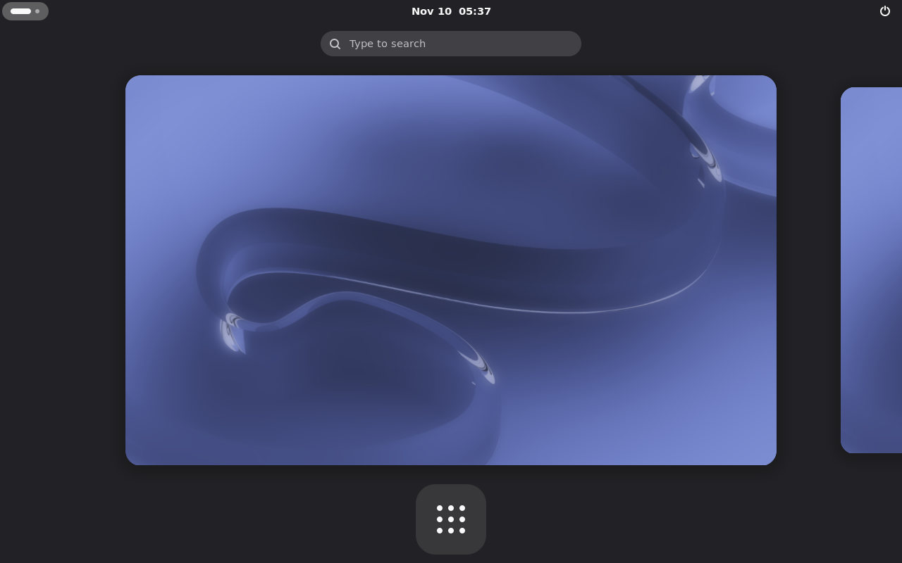
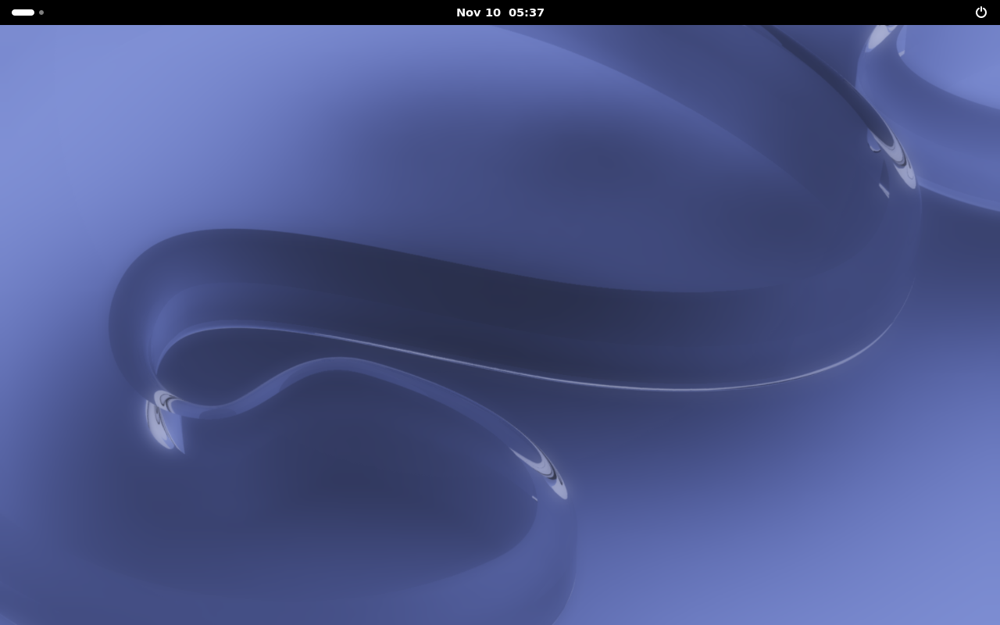
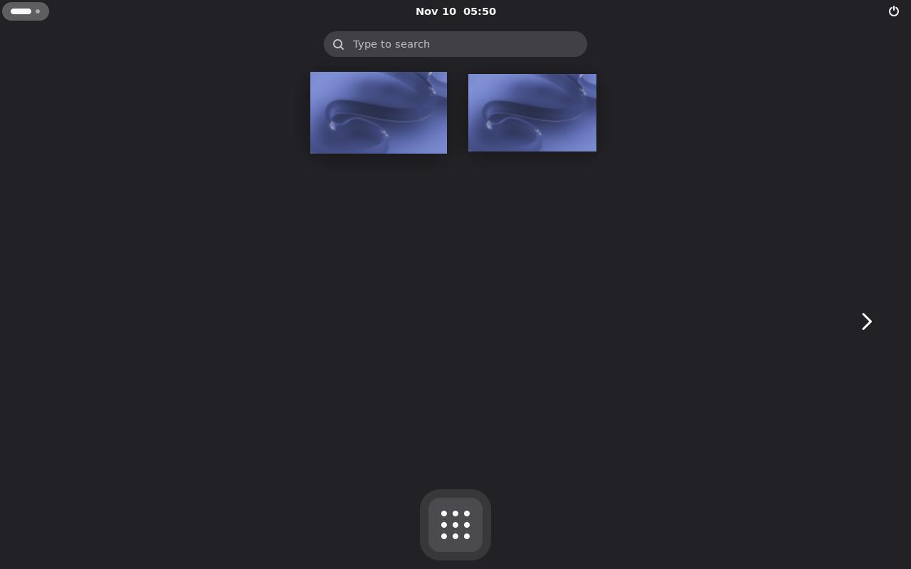
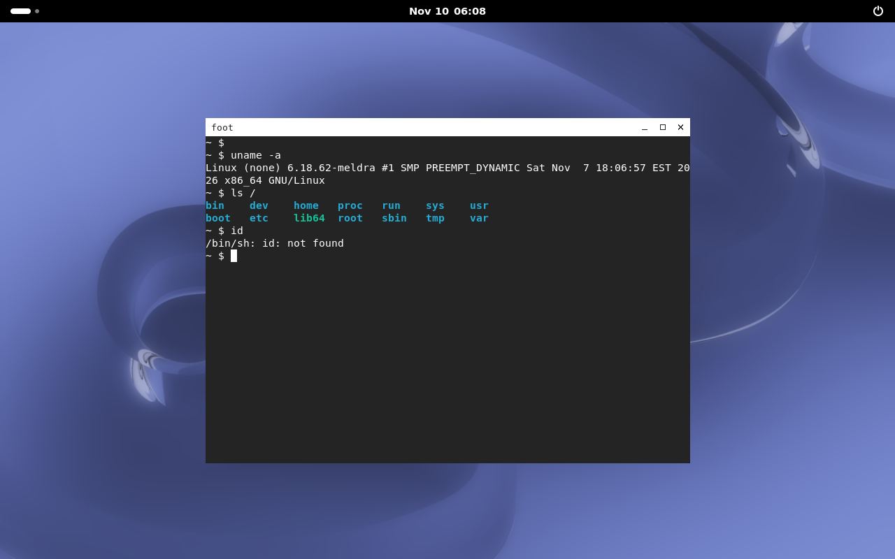
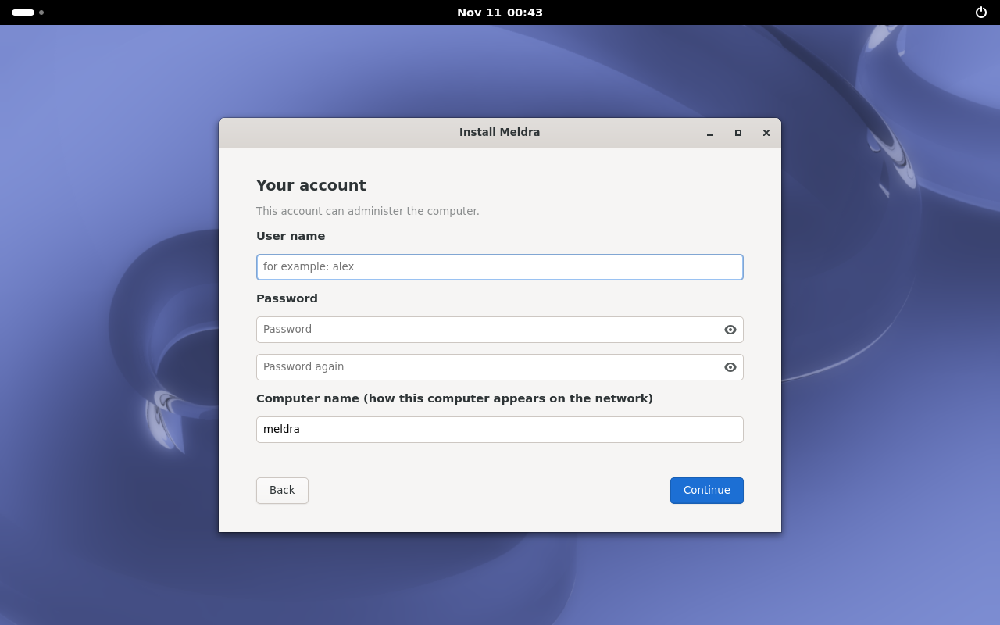
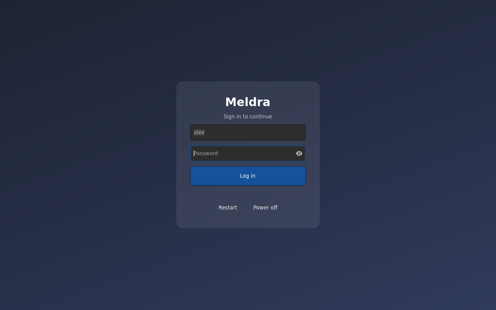

<div align="center">

# Meldra OS

### Linux compatibility. BSD discipline. One carefully engineered system.


</div>

Meldra OS is an experimental operating system that keeps Linux's hardware and
application compatibility while introducing selected BSD designs through
reviewed, testable subsystem boundaries.

This is not a textual splice of two kernel trees. Meldra starts from a pinned
Linux LTS baseline, then evaluates BSD-derived components one subsystem at a
time. Every import needs clear provenance, compatible licensing, measurable
benefit, tests, and a rollback path.

## First graphical milestone

Meldra now boots its own kernel and userspace in QEMU, starts **Hearth** as PID
1, brings up udev and seatd, and launches a native **Labwc** Wayland session.

<p align="center">
  
</p>

<p align="center"><em>The first real compositor frame from Meldra OS. The next visual milestone adds the wallpaper, terminal, panel, and launcher.</em></p>

## GNOME Shell boots

Meldra also boots **GNOME Shell 50.6** as a Wayland display server in QEMU: Hearth starts elogind and D-Bus, a
PAM session is opened for an unprivileged user, and Mutter drives the virtual GPU (software rendering).

<p align="center">
  
</p>

<p align="center"><em>GNOME Shell's Activities Overview on Meldra OS, with the GNOME wallpaper (decoded by glycin
inside its bubblewrap sandbox) and the Adwaita icons.</em></p>

<p align="center">
  
</p>

<p align="center"><em>The same session after a Super key press sent through QEMU: the Shell left the Overview for the
desktop. Both frames come from <code>tools/gnome_smoke.py</code>, which boots the image, waits for the Shell, and checks
that it draws and reacts to the keyboard.</em></p>

<p align="center">
  
</p>

<p align="center"><em>The app grid is driven through QEMU's QMP input path. The current image includes Foot and
three minimal Meldra apps: Files, Text Editor and Settings.</em></p>

<p align="center">
  
</p>

<p align="center"><em>The foot terminal, launched from the app grid by mouse and driven from the keyboard.</em></p>

Working: keyboard and mouse input, the Foot terminal running bash with GNU coreutils, grep, sed, findutils, gawk, less and procps (plus fastfetch with the Meldra logo; busybox remains only as /bin/sh for system scripts), polkit authentication-agent registration, UPower,
AccountsService, GeoClue, RealtimeKit, and power off/reboot from the user's session. Files, Text Editor and Settings
are small Meldra placeholder apps (a file browser, a single-document editor, and a dark-mode switch), not Nautilus,
GNOME Text Editor or GNOME Settings. Wired networking works (DHCP, DNS and HTTP over busybox's udhcpc; no
NetworkManager or Wi-Fi yet, so GNOME shows no network indicator). Audio and hardware acceleration remain.

## Install to disk and log in

The live image has an **Install Meldra** app. It asks for a disk, a user name, a password and a computer name,
then erases the disk and installs Meldra on it: a GPT disk with an EFI system partition and an ext4 root. The
kernel boots straight from the firmware through its EFI stub (no bootloader menu); Secure Boot must be off.
`meldra-install` is the same installer on the command line.

<p align="center">
  
</p>

Installed systems start at Meldra's login screen: greetd runs the login form in the cage kiosk compositor and
starts GNOME after a successful login. (GDM is not used: since GNOME 49 it needs systemd, which Meldra does not use.)
The live image still logs in automatically.

<p align="center">
  
</p>

Checked in QEMU by `tools/install_smoke.py`: install onto a blank disk, boot it with UEFI firmware, reject a wrong
password, log in with the right one. Files, the host name and the account survive reboots. Not yet: choosing a
keyboard layout or time zone in the installer, dual-boot next to another system, disk encryption, and testing on
real hardware.

## What works today

| Area | State | Implementation |
| --- | --- | --- |
| Kernel | Boots | Linux 6.18.62-meldra with a reproducible config fragment |
| Early userspace | Boots | musl-static recovery/initramfs path |
| Main userspace ABI | Built | glibc 2.44 |
| Init system | Running | Hearth service supervisor as PID 1 |
| Package manager | Tested | Kiln packages with dependency and path-safety checks |
| Graphics | Built | DRM, Mesa Softpipe, Wayland, libinput, seatd, wlroots |
| Text and UI | Built | FreeType, Fontconfig, HarfBuzz, FriBidi, Cairo, Pango |
| Window manager | Running | Labwc 0.9.1 on virtio-vga in QEMU |
| Desktop assets | Packaged | Current GNOME backgrounds plus Aqua, Curves, and Sunset |
| GNOME desktop | Usable preview | Shell 50.6, core apps, polkit and desktop daemons run in QEMU; portals remain |
| Install and login | Working in QEMU | Graphical installer (GPT, EFI stub, ext4), greetd login screen, persistent home |

Meldra is a developer preview, not yet an installable daily-driver OS. Audio,
network management, graphical login, a terminal, a panel, and the full GNOME
session are still being integrated.

## Architecture

```text
                         Meldra OS
                            │
          ┌─────────────────┼─────────────────┐
          │                 │                 │
   Linux 6.18 LTS      Meldra userspace   Desktop profiles
   drivers + ABI       Hearth + Kiln      Labwc / GNOME
          │                 │                 │
          └──────── reviewed subsystem adapters ────────┘
                            │
                  selected BSD designs
```

- **Linux remains the compatibility spine.** Drivers, the syscall ABI, and
  mainstream Linux applications keep working throughout development.
- **BSD work is admitted, not assumed.** `components.toml` records provenance,
  ownership, licensing, integration boundaries, and maturity.
- **glibc is the desktop ABI.** musl remains intentionally scoped to static
  recovery and early-boot tools.
- **Upstream updates are the security unit.** Meldra avoids an unauditable pile
  of permanent one-off patches.

## Build and test

The build expects a Linux host with Python 3.11+, a C/C++ toolchain, Meson,
Ninja, CPIO, and QEMU. Downloaded sources are checksum-pinned in
`sources.lock.toml`.

```sh
# Validate component policy, build Hearth, and run the test suite
make check

# Build the kernel and base userspace
make kernel
make packages

# Build the Wayland and desktop dependency stacks
make graphics-packages
make desktop-libs
make fonts
make xkeyboard-config
make labwc

# Assemble and pack the graphical preview from a fresh build tree
make desktop-initramfs

# Boot the real Meldra graphical image
./scripts/run-desktop-preview.sh
```

For the smaller serial-only smoke test:

```sh
make boot-smoke
```

## Meldra-owned components

### Hearth

Hearth is Meldra's compact PID 1 and service supervisor. It mounts the early
filesystems, launches declarative services, reaps child processes, respawns
long-running services, and performs orderly shutdown.

### Kiln

Kiln is Meldra's package format and package manager. Packages carry explicit
dependencies and are installed through traversal-safe, conflict-aware archive
handling. The current implementation is intentionally small enough to audit.

## Repository map

```text
components.toml                 BSD component admission and provenance
sources.lock.toml               pinned upstream versions and checksums
repository.toml                 package dependency and readiness catalog
kernel/config/                  Meldra kernel configuration fragments
init/                           Hearth and service definitions
kiln/                           Kiln package manager
desktop/labwc/                  Meldra Labwc session configuration
profiles/                       base, Labwc, and GNOME installation profiles
assets/wallpapers/              experimental Meldra artwork
docs/                           architecture, boot, desktop, security, roadmap
scripts/                        QEMU smoke and graphical preview launchers
tools/                          reproducible build and assembly pipelines
tests/                          policy, resolver, and package-manager tests
```

## Roadmap

1. Add the wallpaper client, Foot terminal, Fuzzel launcher, and Waybar.
2. Add greetd and a graphical login flow.
3. Move the preview from a large initramfs to an installable disk image.
4. Bring up networking, audio, portals, and Polkit.
5. Port Mutter, GNOME Shell, GDM, and the remaining GNOME platform stack.
6. Begin isolated BSD-subsystem experiments behind stable Linux interfaces.

The detailed delivery gates live in [docs/roadmap.md](docs/roadmap.md), while
[docs/architecture.md](docs/architecture.md) explains the kernel-integration
model and [docs/security.md](docs/security.md) defines vulnerability handling.

## Project rules

1. Keep the system bootable after every integration step.
2. Port one subsystem at a time behind an explicit boundary.
3. Preserve upstream copyright and license notices.
4. Require repeatable builds, tests, and a rollback path.
5. Report limitations honestly—screenshots and status must come from the real
   Meldra image, not a host-side mockup.

---

<div align="center">
  <strong>Meldra OS is under active construction.</strong><br>
  The first desktop frame exists; the usable desktop comes next.
</div>
